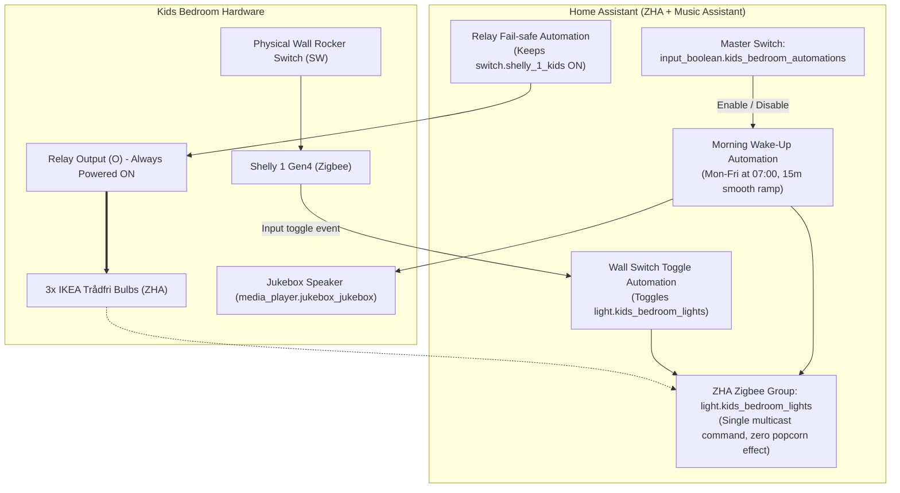

# Spec 10 Plan — Kids Bedroom Lights & Wake-up Automation

## Context
Automate the kids' bedroom lighting and morning wake-up routine using:
- **Shelly 1 (Gen4 with Zigbee)** behind the physical wall switch.
- **3 IKEA Trådfri Zigbee Bulbs** in a single fixture (`light.ikea_kids1`, `light.ikea_kids2`, `light.ikea_kids3`).
- **Speaker**: `media_player.jukebox_jukebox`.
- **Music Assistant Playlist**: ID `19` (`https://music-assistant.internal.pippinn.me/#/playlists/library/19`).
- **Home Assistant ZHA** (Zigbee Home Automation on `/dev/ttyUSB0`).

---

## Architecture & Design

1. **Light Grouping**:
   - A native **ZHA Zigbee Group** (`light.kids_bedroom_lights`) combining `light.ikea_kids1`, `light.ikea_kids2`, and `light.ikea_kids3`. This uses Zigbee multicast so all three bulbs turn on, turn off, and dim in unison without popcorn effect.

2. **Shelly Detached Mode & Zigbee Direct Binding**:
   - The Shelly 1 is configured in **Detached Mode** so the relay stays closed/ON permanently, supplying continuous AC mains power to the IKEA bulbs.
   - The Shelly is **direct-bound via Zigbee** to the ZHA Light Group (`light.kids_bedroom_lights`), allowing the physical wall switch to turn the bulbs on and off directly over the Zigbee mesh even if Home Assistant is offline.
   - *Future Hardware Enhancement*: Installing a clip-in return spring (*impulsfjäder*) behind the physical wall rocker and changing the Shelly Input Mode from **Switch** to **Button** makes the Shelly send Zigbee `Toggle` commands over Direct Binding on every press (eliminating fixed On/Off rocker positions while keeping 100% offline Direct Binding).

3. **Morning Wake-up Automation (07:00 – 07:15, Mon–Fri)**:
   - Triggers at 07:00 on weekdays (Mon–Fri) when `input_boolean.kids_bedroom_automations` is `on`.
   - Light ramp & Color reset: Lights turn on at lowest brightness (1%) with color temperature reset to 2700K (warm white), then use Home Assistant's native hardware `transition: 900` (15 minutes) to smoothly ramp brightness to 100% at 07:15.
   - Music ramp: Music Assistant starts playing playlist `19` on `media_player.jukebox_jukebox` at minimum volume (0.05 / 5%) and ramps volume up to 0.35 (35%) over the same 15 minutes.
   - Non-blocking and interruptible: If the master automation toggle is turned off or someone pauses the music during the routine, the ramp cleanly halts.

4. **Master Automation Control**:
   - `input_boolean.kids_bedroom_automations` provides a single toggle in HA to disable all kids' bedroom scheduled routines (e.g. for holidays, vacations, or sick days).
   - Physical wall switch manual control is **never blocked** by the master switch.

---

## Hardware Configuration Guide: Shelly Detached Mode

To enable Detached Mode on the Shelly 1 Gen4:

### Option A: Via Shelly Web UI / App (Recommended)
1. Open the Shelly web interface (via its IP address) or the Shelly Smart Control app.
2. Navigate to **Settings** (or Device Settings) -> **Input/Output settings**.
3. Select the input (SW) and change **Switch Mode** from *Toggle/Edge* to **Detached**.
4. Set the **Relay Type / Default State** to **ON** (Output turns ON when power is applied).
5. Save settings.

### Option B: Via ZHA Cluster Configuration in Home Assistant
1. In Home Assistant, go to **Settings** -> **Devices & Services** -> **Zigbee Home Automation (ZHA)**.
2. Select the Shelly 1 device (`switch.shelly_1_kids`).
3. Click the three dots `...` -> **Manage Zigbee Device**.
4. Under the relevant Input cluster (e.g., `OnOff` or `MultistateInput`), configure the input detached attribute if exposed by the firmware.

---

## ZHA Group Creation Guide

1. In Home Assistant, go to **Settings** -> **Devices & Services** -> **Zigbee Home Automation (ZHA)**.
2. Click the **Groups** tab at the top.
3. Click **Add Group** (bottom right).
4. Enter Name: `Kids Bedroom Lights` (HA creates `light.kids_bedroom_lights`).
5. Add the 3 members:
   - `light.ikea_kids1`
   - `light.ikea_kids2`
   - `light.ikea_kids3`
6. Click **Add Group**.

---

## Package Implementation

File: `services/home-assistant/config/packages/kids_bedroom.yaml`

Contains:
- `input_boolean.kids_bedroom_automations` (Master enable/disable toggle)
- `script.kids_bedroom_morning_wakeup` (15-minute coordinated light & volume ramp)
- `script.kids_bedroom_stop_morning_routine` (Stops music & turns off lights if cancelled)
- `automation.kids_bedroom_morning_wakeup_auto` (07:00 weekday trigger)
